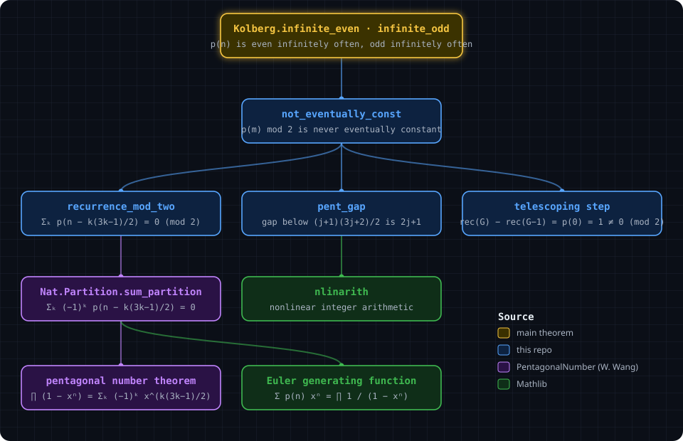

# Kolberg's theorem in Lean 4

[](https://github.com/jackstanton6/kolberg/actions/workflows/ci.yml)

A `sorry`-free Lean 4 / Mathlib proof of **Kolberg's theorem (1959)**: the partition function
$p(n)$ takes even values infinitely often and odd values infinitely often.

```lean
theorem Kolberg.infinite_even : {n : ℕ | Even (Fintype.card (Nat.Partition n))}.Infinite
theorem Kolberg.infinite_odd  : {n : ℕ | Odd  (Fintype.card (Nat.Partition n))}.Infinite
```

<p align="center"></p>

## The math

Euler's generating function combined with the pentagonal number theorem gives

$$\sum_{n\ge 0} p(n)\,x^n \cdot \prod_{m\ge 1}(1-x^m) = 1, \qquad \prod_{m\ge1}(1-x^m)=\sum_{k\in\mathbb{Z}}(-1)^k x^{k(3k-1)/2},$$

so for $n \ge 1$, after reducing mod 2,

$$\sum_{k\,:\,g_k \le n} p(n-g_k) \equiv 0 \pmod 2, \qquad g_k = \tfrac{k(3k-1)}{2}.$$

Suppose $p(m) \equiv c \pmod 2$ for all $m \ge N$. Take $G = g_{j+1} = \tfrac{(j+1)(3j+2)}{2}$ with
$j = N+1$. The next pentagonal number below $G$ is $g_{-j} = G-(2j+1)$, so every $g_k < G$ has
$G - g_k > N$. Subtracting the recurrence at $G-1$ from the one at $G$ gives

$$0 \equiv p(0) + \sum_{g_k<G}\bigl(p(G-g_k)-p(G-1-g_k)\bigr) \equiv 1 + \sum (c-c) \equiv 1 \pmod 2,$$

a contradiction. So the parity of $p(n)$ is never eventually constant. $\blacksquare$

`Kolberg/Conjectures.lean` also states the open **Parkin–Shanks conjecture** and weaker
positive-density versions. These are statements only, with no proofs:

```math
\lim_{N\to\infty} \frac{\#\{\, n < N : p(n) \text{ odd} \,\}}{N} = \frac12 .
```

## Build

```bash
lake exe cache get && lake build
lake env lean AxiomCheck.lean   # only propext, Classical.choice, Quot.sound
```

## Credits

- **Weiyi Wang**, [PentagonalNumberTheorem](https://github.com/wwylele/PentagonalNumberTheorem):
  the Lean proof of the pentagonal number theorem and the recurrence `Nat.Partition.sum_partition`.
- **The Mathlib community**: `Nat.Partition`, Euler's generating function, power series.
- O. Kolberg, *Note on the parity of the partition function*, Math. Scand. **7** (1959), 377–378.
- M. Newman, *Periodicity modulo m and divisibility properties of the partition function*,
  Trans. AMS **97** (1960), 225–236.
- R. E. Parkin, D. Shanks, *On the distribution of parity in the partition function*,
  Math. Comp. **21** (1967), 466–480.
